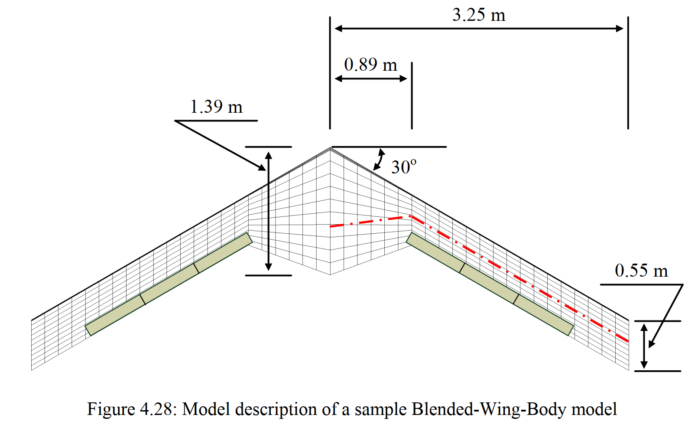
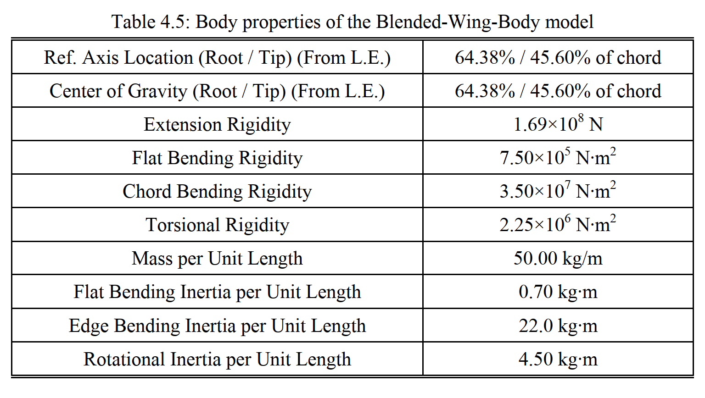
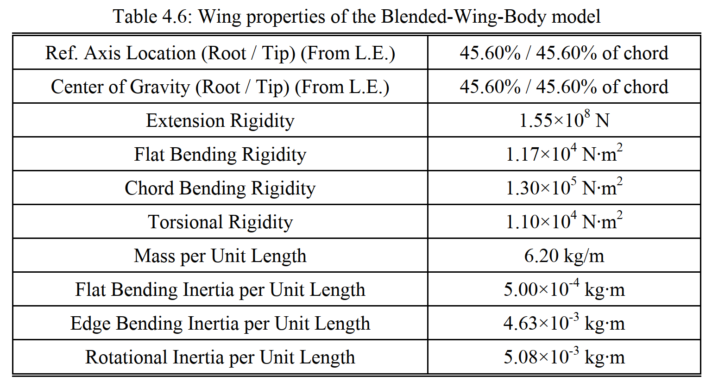

```@meta
EditURL = "../../../test/examples/eigenAeroelastic/BWBflutter.jl"
```

# Flutter of a Blended-Wing-Body
This example illustrates how to set up a flutter analysis of an aircraft in free flight. For that we take a Blended-Wing-Body (BWB) vehicle, a swept flying-wing with trailing-edge control surfaces. This aircraft model was described in [Weihua Su's PhD thesis](https://www.proquest.com/docview/304572531?pq-origsite=gscholar&fromopenview=true&sourcetype=Dissertations%20&%20Theses):


*BWB model geometry* by [Su](https://www.proquest.com/docview/304572531?pq-origsite=gscholar&fromopenview=true&sourcetype=Dissertations%20&%20Theses)


*BWB's body properties* by [Su](https://www.proquest.com/docview/304572531?pq-origsite=gscholar&fromopenview=true&sourcetype=Dissertations%20&%20Theses)


*BWB's wing properties* by [Su](https://www.proquest.com/docview/304572531?pq-origsite=gscholar&fromopenview=true&sourcetype=Dissertations%20&%20Theses)

!!! tip
    The code for this example is available [here](https://github.com/luizpancini/AeroBeams.jl/blob/main/test/examples/eigenAeroelastic/BWBflutter.jl).

### Problem setup
Let's begin by setting up the variables of our problem.

````@example BWBflutter
using AeroBeams

# Airspeed range [m/s]
URange = collect(30:2:160)

# Flight altitude [m]
h = 0e3

# Aerodynamic solver
aeroSolver = Inflow()

# Trim system solver
NR = create_NewtonRaphson(trimSolverMethod=:LM)

# Number of modes to track
nModes = 8

# Eigensolver method and minimum number of eigenvalues to be computed
eigenmethod = :krylovkit
nev = 80

# Initialize outputs
eigenProblem = Array{EigenProblem}(undef,length(URange))
trimAoA = Array{Float64}(undef,length(URange))
trimThrust = Array{Float64}(undef,length(URange))
trimδ = Array{Float64}(undef,length(URange))
eigensols = Array{EigenSolution}(undef,length(URange))
nothing #hide
````

Next, we address an important step to be taken when performing flutter analyses in free flight with AeroBeams: to attach the model to light springs in displacement and rotation. This step is necessary for the solver to find the flight dynamic (rigid-body) modes of the vehicle, by introducing some sensitivity of the finite element states to those degrees-of-freedom. In the present case, we will attach two springs to the vehicle, one at each of the nodes where the transition from the body (fuselage) to the wing begins. An appropriate value for the stiffness of the springs is specified by the variable `μ`.

````@example BWBflutter
# Attachment spring stiffness
μ = 1e-2
nothing #hide
````

### Problem solution
At this point we can sweep the airspeed vector to find the solution at each value.

````@example BWBflutter
# Initial guess solution
x0 = zeros(0)
# Sweep airspeed range
for (i,U) in enumerate(URange)
    # The first step of the solution is to trim the aircraft at that flight condition (combination of altitude and airspeed). We leverage the built-in function in AeroBeams to create our model for the trim problem.
    BWBtrim = first(create_BWB(aeroSolver=aeroSolver,altitude=h,airspeed=U,δElevIsTrimVariable=true,thrustIsTrimVariable=true))
    # Root element's global ID.
    rootElemGlobalID = BWBtrim.beams[3].elements[1].assemblyData.globalID
    # Now we create and solve the trim problem.
    trimProblem = create_TrimProblem(model=BWBtrim,systemSolver=NR,x0=x0)
    solve!(trimProblem)
    # We extract the trim variables at the current airspeed and set them into our pre-allocated arrays. The trimmed angle of attack at the root, `trimAoA`, is not necessary for the flutter analyses, it is merely an output of interest.
    trimSol = trimProblem.trimSolution
    aeroVars = trimProblem.loadstepHistory.aeroVariables
    trimAoA[i] = rad2deg(aeroVars[end][rootElemGlobalID].unsteadyKin.αₑ)
    trimThrust[i] = trimSol.trimLoads[1]
    trimδ[i] = trimSol.trimδ[1]
    # Set initial guess solution for next iteration.
    global x0 = trimProblem.systemArrays.x
    # Let's create a new model with attachment springs.
    BWBtrimSpringed = first(create_BWB(aeroSolver=aeroSolver,altitude=h,airspeed=U,δElevIsTrimVariable=true,thrustIsTrimVariable=true,withAttachmentSprings=true,μ=μ))
    # Then create and solve the trim problem for the springed model.
    trimProblemSpringed = create_TrimProblem(model=BWBtrimSpringed,systemSolver=NR,x0=x0)
    solve!(trimProblemSpringed)
    # Let's make sure that the trim outputs of the springed model are very close to the one without springs, that is, the springs did not affect the trim solution. Notice that all ratios are very close to or at 1.
    trimAoASpringed = rad2deg(trimProblemSpringed.loadstepHistory.aeroVariables[end][rootElemGlobalID].unsteadyKin.αₑ)
    trimThrustSpringed = trimProblemSpringed.trimSolution.trimLoads[1]
    trimδSpringed = trimProblemSpringed.trimSolution.trimδ[1]
    println("Trim outputs' ratios springed/nominal: AoA = $(round(trimAoASpringed/trimAoA[i],sigdigits=4)), thrust = $(round(trimThrustSpringed/trimThrust[i],sigdigits=4)), δ = $(round(trimδSpringed/trimδ[i],sigdigits=4))")
    # All the variables needed for the stability analysis are now in place. We create the model for the eigenproblem, using the trim variables found previously with the springed model in order to solve for the stability around that exact state.
    BWBeigen = first(create_BWB(aeroSolver=aeroSolver,altitude=h,airspeed=U,δElev=trimδSpringed,thrust=trimThrustSpringed,withAttachmentSprings=true,μ=μ))
    # Now we create and solve the eigenproblem. Notice that by using `solve_eigen!()`, we skip the step of finding the steady state of the problem, making use of the known trim solution (with the keyword argument `refTrimProblem`)
    eigenProblem[i] = create_EigenProblem(model=BWBeigen,eigenmethod=eigenmethod,nev=nev,refTrimProblem=trimProblemSpringed)
    solve_eigen!(eigenProblem[i])
    # The final step in the loop is extracting the eigensolution
    eigensols[i] = eigenProblem[i].eigensolution
end
nothing #hide
````

### Post-processing
We can use the AeroBeams built-in function [`mode_tracking`](@ref mode_tracking) to enhance the chances of correctly tracking the frequencies and dampings of each mode

````@example BWBflutter
# Mode tracking
freqs,damps,modeShapes,_ = mode_tracking(eigensols)

# Get frequencies and dampings of oscillatory modes
freqsOsc,dampsOsc,modeShapesOsc,keptTracks = filter_tracked_modes(freqs,damps,modeShapes; fmin=1e0, fmax=150, maxTracks=nModes, dropOutsideBounds=true)
nothing #hide
````

The flutter onset speeds and frequencies are computed

````@example BWBflutter
# Flutter onset speeds, frequencies and modes
flutterSpeeds,flutterFreqs,flutterModes,flutterInds,_ = find_flutter(URange,freqsOsc,dampsOsc,1:length(URange))
for (mode,speed,freq) in zip(flutterModes,flutterSpeeds,flutterFreqs)
    println("Mode $mode: flutter speed = $(round(speed,sigdigits=4)) m/s, flutter frequency = $(round(freq,digits=2)) rad/s")
end
````

We can load the reference solution found with the University of Michigan's Nonlinear Aeroelastic Simulation Tool (UM/NAST) in its 2024 version (not the version in Su's thesis).

````@example BWBflutter
# Load reference data
trimAoARef = readdlm(pkgdir(AeroBeams)*"/test/referenceData/BWB/trimAoA.txt")
trimThrustRef = readdlm(pkgdir(AeroBeams)*"/test/referenceData/BWB/trimThrust.txt")
trimδRef = readdlm(pkgdir(AeroBeams)*"/test/referenceData/BWB/trimDelta.txt")
freqsRef = readdlm(pkgdir(AeroBeams)*"/test/referenceData/BWB/freqs.txt")
dampsRef = readdlm(pkgdir(AeroBeams)*"/test/referenceData/BWB/damps.txt")
nothing #hide
````

We are ready to plot the results. The following plots show the trim root angle of attack, motor thrust and elevator deflection as functions of the airspeed. The correlation with the reference solution is very good, except for the thrust. This difference arises because of the way in which the airfoil tangential force is computed when a flap deflection is present: either as proportional to the total normal force, which includes the flap-induced component (in AeroBeams), or proportional to the effective angle of attack (in UM/NAST).

````@example BWBflutter
using Suppressor #hide
using Plots
gr()
ENV["GKSwstype"] = "100" #hide
nothing #hide

# Root AoA
plt1 = plot(xlabel="Airspeed [m/s]", ylabel="Trim root AoA [deg]", xlims=[0,160], xticks=vcat(30:10:160))
plot!(URange, trimAoA, c=:black, lw=2, label="AeroBeams")
scatter!(trimAoARef[1,:],trimAoARef[2,:], c=:black, ms=4, label="UM/NAST")
savefig("BWBflutter_AoA.svg") #hide

# Thrust
plt2 = plot(xlabel="Airspeed [m/s]", ylabel="Trim thrust [N]", xlims=[30,160], xticks=vcat(0:10:160), legend=:bottomright)
plot!(URange, trimThrust, c=:black, lw=2, label="AeroBeams")
scatter!(trimThrustRef[1,:],trimThrustRef[2,:], c=:black, ms=4, label="UM/NAST")
savefig("BWBflutter_thrust.svg") #hide

# Elevator deflection
plt3 = plot(xlabel="Airspeed [m/s]", ylabel="Trim elevator deflection [deg]", xlims=[30,160], xticks=vcat(0:10:160), legend=:bottomright)
plot!(URange, trimδ*180/π, c=:black, lw=2, label="AeroBeams")
scatter!(trimδRef[1,:],trimδRef[2,:], c=:black, ms=4, label="UM/NAST")
savefig("BWBflutter_delta.svg") #hide
nothing #hide
````


The stability results can be visualized through the following root locus and V-g-f (frequency and damping evolution) plots. The lowest flutter speed is computed by AeroBeams at approximately 118.1 m/s, at a frequency of 47.9 rad/s. Conversely, the flutter speed and frequency predicted by UM/NAST are around 137.7 m/s and 47.5 rad/s, yielding differences of 14% and 0.8%, on speed and frequency, respectively. Despite the flutter speed disagreement, there is qualitatively good agreement among the models for the behavior of the roots.

````@example BWBflutter
# Colormap
modeColors = cgrad(:rainbow, nModes, categorical=true)

# Root locus
plt4 = plot(xlabel="Damping [1/s]", ylabel="Frequency [rad/s]", xlims=[-35,5],ylims=[0,125])
scatter!([NaN],[NaN], c=:black, shape=:circle, ms=4, msw=0, label="AeroBeams")
scatter!([NaN],[NaN], c=:black, shape=:utriangle, ms=4, msw=0, label="UM/NAST")
for mode in 1:nModes
scatter!(dampsRef[mode+1,:], Hz2rads.(freqsRef[mode+1,:]), c=:black, shape=:utriangle, ms=4, msw=0, label=false)
scatter!(dampsOsc[mode,:], freqsOsc[mode,:], c=modeColors[mode], shape=:circle, ms=4, msw=0, label=false)
end
savefig("BWBflutter_rootlocus.svg") #hide

# V-g-f
plt51 = plot(ylabel="Frequency [rad/s]", xlims=[30,160], xticks=0:10:160, ylims=[0,125])
for mode in 1:nModes
plot!(URange, freqsOsc[mode,:], c=modeColors[mode], shape=:circle, ms=4, msw=0, label=false)
end
plt52 = plot(xlabel="Airspeed [m/s]", ylabel="Damping ratio", xlims=[30,160], ylims=[-0.3,0.2], xticks=30:10:160, yticks=-0.3:0.1:0.2)
for mode in 1:nModes
plot!(URange, dampsOsc[mode,:]./freqsOsc[mode,:], c=modeColors[mode], shape=:circle, ms=4, msw=0, label=false)
end
plt5 = plot(plt51,plt52, layout=(2,1))
savefig("BWBflutter_Vgf.svg") #hide
nothing #hide
````


Finally, we may visualize the mode shapes of the last eigenproblem (at highest airspeed), making use of the [`plot_mode_shapes`](@ref plot_mode_shapes) function with the appropriate inputs. Modes 1 and 2 seem to respectively be lateral-directional and longitudinal flight dynamic modes, whereas the others are structural.

````@example BWBflutter
# Plot mode shapes
@suppress begin #hide
modesPlot = plot_mode_shapes(eigenProblem[end],modeShapes=modeShapesOsc[:,end],modeNumbers=collect(1:nModes),scale=1,view=(45,30),element2centralize=11,legendPos=(0.6,0.95),modalColorScheme=:rainbow)
end #hide
savefig("BWBflutter_modeShapes.svg") #hide
nothing #hide
````


---

*This page was generated using [Literate.jl](https://github.com/fredrikekre/Literate.jl).*

