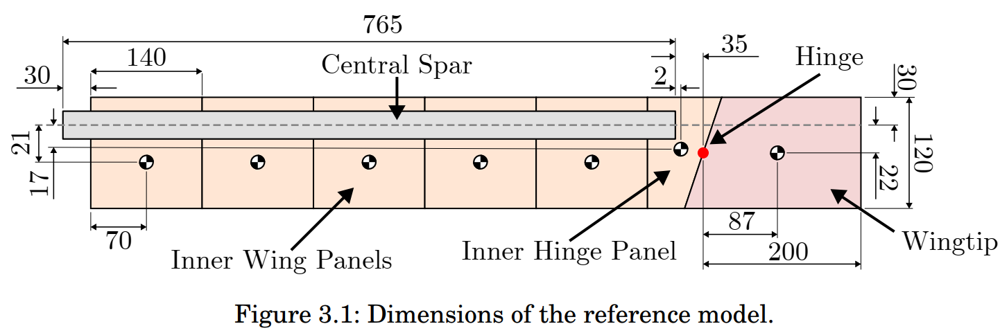

```@meta
EditURL = "../../../test/examples/eigenAeroelastic/HealyBaselineFFWTfreeFlutterAoARangeURange.jl"
```

# Flutter analysis of a wing with flared folding wingtip (FFWT)
This example illustrates how to set up a flutter analysis for a wing featuring a flared folding wingtip (FFWT). The influence of the root pitch angle on the behavior of this wing model was studied numerically in [Healy's PhD Thesis](https://research-information.bris.ac.uk/ws/portalfiles/portal/388426634/Final_Copy_2024_01_23_Healy_F_PhD_Redacted.pdf).



*Top view of baseline wing model featuring a FFWT* by [Healy et al.](https://doi.org/10.2514/6.2023-0376)

!!! tip
    The code for this example is available [here](https://github.com/luizpancini/AeroBeams.jl/blob/main/test/examples/eigenAeroelastic/HealyBaselineFFWTfreeFlutterAoARangeURange.jl).

### Problem setup
Let's begin by setting the variables of our problem. In this example we will analyze the coasting angle and stability of the free FFWT under several root pitch angles. The flare angle of the wingtip is of 15 degrees, and the airspeed is varied. The influence of three-dimensional aerodynamic effects is investigated through the tip loss factor, for which two values are assumed (one leading to some tip loss, and another leading to no tip loss). The hinge is assumed as a universal joint but with the axis of rotation constraint. Only the flutter mechanism arising from the interaction of the first two modes (the wingtip flapping mode and the first OOP bending mode) is analyzed.

````@example HealyBaselineFFWTfreeFlutterAoARangeURange
using AeroBeams

# Hinge configuration
hingeConfiguration = :free

# Tip loss factor range
τRange = [12,Inf]

# Pitch angle range [rad]
θRange = deg2rad.([0,3,6])

# Airspeed range [m/s]
URange = collect(1:1:40)

# Discretization
nElementsInner = 16
nElementsFFWT = 4

# System solver
systemSolver = create_NLsolver(method=:newton,linesearch=true)

# Number of modes to track
nModes = 2

# Eigensolver method and minimum number of eigenvalues to be computed
eigenmethod = :krylovkit
nev = 50

# Initialize outputs
eigensols = Array{EigenSolution}(undef,length(τRange),length(θRange),length(URange))
freqsOsc = Array{Matrix{Float64}}(undef,length(τRange),length(θRange))
dampsOsc = Array{Matrix{Float64}}(undef,length(τRange),length(θRange))
ϕHinge = Array{Float64}(undef,length(τRange),length(θRange),length(URange))
nothing #hide
````

### Solving the problem
In the following loops, we create new model instances for each combination of tip loss decay factor, pitch angle and airspeed, create and solve the eigen problem, and then extract the coasting angle of the FFWT (`ϕHinge`) and the frequencies, dampings and eigenvectors. The model creation process is streamlined with the function [`create_HealyBaselineFFWT`](@ref create_HealyBaselineFFWT), taking the appropriate inputs.

````@example HealyBaselineFFWTfreeFlutterAoARangeURange
using Suppressor #hide
# Sweep tip loss factor
for (i,τ) in enumerate(τRange)
    # Sweep pitch angle
    for (j,θ) in enumerate(θRange)
        # Initialize guess solution
        x0 = zeros(0)
        # Sweep airspeed
        for (k,U) in enumerate(URange)
            # Update model
            model = create_HealyBaselineFFWT(hingeConfiguration=hingeConfiguration,airspeed=U,pitchAngle=θ,hasTipCorrection=true,tipLossDecayFactor=τ,nElementsInner=nElementsInner,nElementsFFWT=nElementsFFWT)
            # Create and solve problem
            problem = create_EigenProblem(model=model,systemSolver=systemSolver,x0=x0,eigenmethod=eigenmethod,nev=nev)
        @suppress begin #hide
            solve!(problem)
        end #hide
            # Eigensolution
            eigensols[i,j,k] = problem.eigensolution
            # Hinge fold (coasting) angle
            ϕHinge[i,j,k] = -rad2deg(problem.model.hingeAxisConstraints[1].state.ϕ)
            # Set initial guess solution for next iteration
            x0 = problem.systemArrays.x
        end
        # Apply mode tracking
        freqs,damps,_ = mode_tracking(eigensols[i,j,:])
        # Get frequencies and dampings of oscillatory modes
        freqsOsc[i,j],dampsOsc[i,j],_ = filter_tracked_modes(freqs,damps; fmin=Hz2rads(1e-1), maxTracks=nModes)
    end
end
nothing #hide
````

### Post-processing
The post-processing begins by loading the reference data.

````@example HealyBaselineFFWTfreeFlutterAoARangeURange
# Load reference data
fold_ST = readdlm(pkgdir(AeroBeams)*"/test/referenceData/HealyBaselineFFWTfreeFlutterAoARangeURange/fold_ST.txt")
fold_VLM = readdlm(pkgdir(AeroBeams)*"/test/referenceData/HealyBaselineFFWTfreeFlutterAoARangeURange/fold_VLM.txt")
freq1_ST = readdlm(pkgdir(AeroBeams)*"/test/referenceData/HealyBaselineFFWTfreeFlutterAoARangeURange/freq1_ST.txt")
freq2_ST = readdlm(pkgdir(AeroBeams)*"/test/referenceData/HealyBaselineFFWTfreeFlutterAoARangeURange/freq2_ST.txt")
freq1_VLM = readdlm(pkgdir(AeroBeams)*"/test/referenceData/HealyBaselineFFWTfreeFlutterAoARangeURange/freq1_VLM.txt")
freq2_VLM = readdlm(pkgdir(AeroBeams)*"/test/referenceData/HealyBaselineFFWTfreeFlutterAoARangeURange/freq2_VLM.txt")
damp1_ST = readdlm(pkgdir(AeroBeams)*"/test/referenceData/HealyBaselineFFWTfreeFlutterAoARangeURange/damp1_ST.txt")
damp2_ST = readdlm(pkgdir(AeroBeams)*"/test/referenceData/HealyBaselineFFWTfreeFlutterAoARangeURange/damp2_ST.txt")
damp1_VLM = readdlm(pkgdir(AeroBeams)*"/test/referenceData/HealyBaselineFFWTfreeFlutterAoARangeURange/damp1_VLM.txt")
damp2_VLM = readdlm(pkgdir(AeroBeams)*"/test/referenceData/HealyBaselineFFWTfreeFlutterAoARangeURange/damp2_VLM.txt")

# Adjust data for plots by padding matrices with NaN
matrices = Dict(
    :fold_ST => fold_ST,
    :fold_VLM => fold_VLM,
    :freq1_ST => freq1_ST,
    :freq2_ST => freq2_ST,
    :freq1_VLM => freq1_VLM,
    :freq2_VLM => freq2_VLM,
    :damp1_ST => damp1_ST,
    :damp2_ST => damp2_ST,
    :damp1_VLM => damp1_VLM,
    :damp2_VLM => damp2_VLM,
)
for key in keys(matrices)
    matrices[key] .= [x == "" ? NaN : x for x in matrices[key]]
end
fold_ST = matrices[:fold_ST]
fold_VLM = matrices[:fold_VLM]
freq1_ST = matrices[:freq1_ST]
freq2_ST = matrices[:freq2_ST]
freq1_VLM = matrices[:freq1_VLM]
freq2_VLM = matrices[:freq2_VLM]
damp1_ST = matrices[:damp1_ST]
damp2_ST = matrices[:damp2_ST]
damp1_VLM = matrices[:damp1_VLM]
damp2_VLM = matrices[:damp2_VLM]

nothing #hide

#
````

We can now plot the coasting (fold) angle of the FFWT and the evolution of the frequencies and dampings of the modes of vibration as functions of airspeed for each root pitch angle. The following reference results were taken from Fig. 3.32 of [Healy's PhD Thesis](https://research-information.bris.ac.uk/ws/portalfiles/portal/388426634/Final_Copy_2024_01_23_Healy_F_PhD_Redacted.pdf). Healy's numerical method is composed of a Rayleigh-Ritz structural model coupled to a vortex-lattice method (VLM) or strip-theory (ST) method for aerodynamics, with the flared folding wingtip being modeled as a point inertia connected to the inner wing via a hinge. The behavior of the fold angle is captured with reasonable accuracy, and the correlation of the frequencies and dampings with the reference data is also good, except for the fact that AeroBeams predicts smaller damping magnitudes.

````@example HealyBaselineFFWTfreeFlutterAoARangeURange
colors = cgrad(:rainbow, length(θRange), categorical=true)
lw = 2
gr()
ENV["GKSwstype"] = "100" #hide

# Fold angle - without tip loss
plt1 = plot(xlabel="Airspeed [m/s]", ylabel="Fold angle [deg]", xlims=[0,40], ylims=[-90,30], yticks=-90:30:30, title="Without tip loss", legend=:bottomright)
plot!([NaN],[NaN], lc=:black, ls=:dash, lw=lw, label="Healy (2023) - ST")
plot!([NaN],[NaN], lc=:black, ls=:solid, lw=lw, label="AeroBeams")
for (j,θ) in enumerate(θRange)
    plot!(fold_ST[2*j-1,:],fold_ST[2*j,:], c=colors[j], ls=:dash, lw=lw, label=false)
    plot!(URange, ϕHinge[2,j,:], c=colors[j], lw=lw, label="\$\\theta = $(round(Int,θ*180/π)) \\degree\$")
end
savefig("HealyBaselineFFWTfreeFlutterAoARangeURange_fold_tipLoss0.svg") #hide

# Fold angle - with tip loss
plt2 = plot(xlabel="Airspeed [m/s]", ylabel="Fold angle [deg]", xlims=[0,40], ylims=[-90,30], yticks=-90:30:30, title="With tip loss", legend=:bottomright)
plot!([NaN],[NaN], lc=:black, ls=:dash, lw=lw, label="Healy (2023) - VLM")
plot!([NaN],[NaN], lc=:black, ls=:solid, lw=lw, label="AeroBeams")
for (j,θ) in enumerate(θRange)
    plot!(fold_VLM[2*j-1,:],fold_VLM[2*j,:], c=colors[j], ls=:dash, lw=lw, label=false)
    plot!(URange, ϕHinge[1,j,:], c=colors[j], lw=lw, label="\$\\theta = $(round(Int,θ*180/π)) \\degree\$")
end
savefig("HealyBaselineFFWTfreeFlutterAoARangeURange_fold_tipLoss1.svg") #hide

# V-g-f - without tip loss
plt31 = plot(ylabel="Frequency [Hz]", xlims=[0,30], ylims=[0,5], title="Without tip loss", legend=:bottomright)
plt32 = plot(xlabel="Airspeed [m/s]", ylabel="Damping Ratio", xlims=[0,30], ylims=[-0.5,0.25], legend=:bottomleft)
plot!(plt31, [NaN],[NaN], lc=:black, ls=:dash, lw=lw, label="Healy (2023) - ST")
plot!(plt31, [NaN],[NaN], lc=:black, ls=:solid, lw=lw, label="AeroBeams")
for (j,θ) in enumerate(θRange)
    for mode in 1:nModes
        plot!(plt31, URange, rads2Hz.(freqsOsc[2,j][mode,:]), c=colors[j], lw=lw, label=false)
        plot!(plt32, URange, dampsOsc[2,j][mode,:]./freqsOsc[2,j][mode,:], c=colors[j], lw=lw, label=false)
    end
    plot!(plt31, freq1_ST[2*j-1,:], freq1_ST[2*j,:], c=colors[j], ls=:dash, lw=lw, label=false)
    plot!(plt31, freq2_ST[2*j-1,:], freq2_ST[2*j,:], c=colors[j], ls=:dash, lw=lw, label=false)
    plot!(plt32, damp1_ST[2*j-1,:], damp1_ST[2*j,:], c=colors[j], ls=:dash, lw=lw, label=false)
    plot!(plt32, damp2_ST[2*j-1,:], damp2_ST[2*j,:], c=colors[j], ls=:dash, lw=lw, label=false)
    plot!(plt32,[NaN],[NaN], c=colors[j], ls=:solid, lw=lw, label="\$\\theta = $(round(Int,θ*180/π)) \\degree\$")
end
plt3 = plot(plt31,plt32, layout=(2,1))
savefig("HealyBaselineFFWTfreeFlutterAoARangeURange_Vgf_tipLoss0.svg") #hide

# V-g-f - with tip loss
plt41 = plot(ylabel="Frequency [Hz]", xlims=[0,30], ylims=[0,5], title="With tip loss", legend=:bottomright)
plt42 = plot(xlabel="Airspeed [m/s]", ylabel="Damping Ratio", xlims=[0,30], ylims=[-0.5,0.25], legend=:bottomleft)
plot!(plt41, [NaN],[NaN], lc=:black, ls=:dash, lw=lw, label="Healy (2023) - VLM")
plot!(plt41, [NaN],[NaN], lc=:black, ls=:solid, lw=lw, label="AeroBeams")
for (j,θ) in enumerate(θRange)
    for mode in 1:nModes
        plot!(plt41, URange, rads2Hz.(freqsOsc[1,j][mode,:]), c=colors[j], lw=lw, label=false)
        plot!(plt42, URange, dampsOsc[1,j][mode,:]./freqsOsc[1,j][mode,:], c=colors[j], lw=lw, label=false)
    end
    plot!(plt41, freq1_VLM[2*j-1,:], freq1_VLM[2*j,:], c=colors[j], ls=:dash, lw=lw, label=false)
    plot!(plt41, freq2_VLM[2*j-1,:], freq2_VLM[2*j,:], c=colors[j], ls=:dash, lw=lw, label=false)
    plot!(plt42, damp1_VLM[2*j-1,:], damp1_VLM[2*j,:], c=colors[j], ls=:dash, lw=lw, label=false)
    plot!(plt42, damp2_VLM[2*j-1,:], damp2_VLM[2*j,:], c=colors[j], ls=:dash, lw=lw, label=false)
    plot!(plt42,[NaN],[NaN], c=colors[j], ls=:solid, lw=lw, label="\$\\theta = $(round(Int,θ*180/π)) \\degree\$")
end
plt4 = plot(plt41,plt42, layout=(2,1))
savefig("HealyBaselineFFWTfreeFlutterAoARangeURange_Vgf_tipLoss1.svg") #hide

nothing #hide
````


---

*This page was generated using [Literate.jl](https://github.com/fredrikekre/Literate.jl).*

