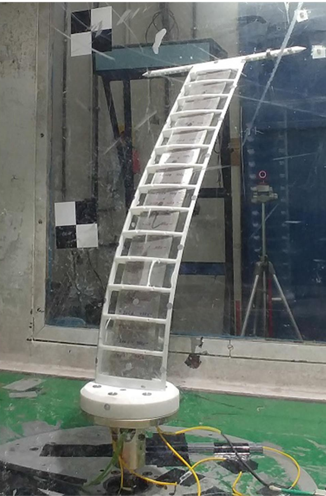

```@meta
EditURL = "../../../test/examples/steadyAeroelastic/PazyWingPitchRange.jl"
```

# Steady aeroelastic analysis of the Pazy wing
This example illustrates how to set up a steady aeroelastic analysis, using the Technion's Pazy wing benchmark. The sectional properties of the wing's spar and the aerodynamic tip loss function were defined by [Riso and Cesnik](https://doi.org/10.2514/6.2022-2313). The data is publicly available at [https://github.com/UM-A2SRL/AePW3-LDWG](https://github.com/UM-A2SRL/AePW3-LDWG).



*Pazy wing in the wind tunnel* by [Avin et al.](https://doi.org/10.2514/1.J060621)

!!! tip
    The code for this example is available [here](https://github.com/luizpancini/AeroBeams.jl/blob/main/test/examples/steadyAeroelastic/PazyWingPitchRange.jl).

### Problem setup
Let's begin by setting the variables of our problem. In this example we will analyze the displacements and twist of the clamped wing under several combinations of root pitch angle and airspeed, which are defined by the arrays `θRange` and `URange`. The wing was tested with a balance mass of 0.01 kg attached to its tip store, at a position of 40 mm behind the trailing-edge. Notice that we bring into scope some fixed geometrical and discretization properties of the wing's beam through the function [`geometrical_properties_Pazy`](@ref geometrical_properties_Pazy).

````@example PazyWingPitchRange
using AeroBeams

# Aerodynamic solver
aeroSolver = Indicial()

# Airfoil section
airfoil = deepcopy(NACA0018)

# Flag for upright position
upright = true

# Mesh (defines number of elements)
mesh = :nominal

# Flag to use AePW3 matrices for sectional stiffness
useAePW3Matrices = false

# Fixed geometrical and discretization properties
nElem,L,chord,normSparPos,nodalPositions = geometrical_properties_Pazy(; mesh=mesh, useAePW3Matrices=useAePW3Matrices)

# Tip mass (for test 1, 0.01 kg, 40 mm behind the trailing-edge)
tipMass = 0.01
ηtipMass = [0; -chord*(1-normSparPos)-0.04; 0]

# Strain gauge coordinates (the spar cs is 60 x 2.25 mm)
SGelem = 3          # element number where the strain gauge is located (see Fig. 12 of https://doi.org/10.2514/1.J060621: FBG^1_3 is @ 127 mm spanwise, but wing root is at 32 mm -> actual spanwise position is 127 - 32 = 95 mm which is at the midpoint of element 3)
x2SG = 50e-3/2      # chordwise position: close to LE
x3SG = 2.25e-3/2    # height: on top

# Root pitch angle [rad] and airspeed [m/s] ranges
θRange = deg2rad.([3,5,7])
URange = vcat(1e-3,1:1:60)

# Initialize outputs
problem = Array{SteadyProblem}(undef,length(θRange),length(URange))
tip_OOP = Array{Float64}(undef,length(θRange),length(URange))
tip_IP = Array{Float64}(undef,length(θRange),length(URange))
tip_twist = Array{Float64}(undef,length(θRange),length(URange))
tip_AoA = Array{Float64}(undef,length(θRange),length(URange))
eps_SG = Array{Float64}(undef,length(θRange),length(URange))
nothing #hide
````

### Solving the problem
In the following loops, we create new model instances with the combination of pitch angle and airspeed, create and solve the steady problem, and then extract the outputs of interest. The model creation process is streamlined with the function [`create_Pazy`](@ref create_Pazy), taking the appropriate inputs. Notice that the twist angle is computed as the arcsine of the difference in "height" between the leading edge and trailing edge of the wingtip (throught the rotation of the local basis vector pointing in the x2-direction).

````@example PazyWingPitchRange
# Sweep root angle
for (i,θ) in enumerate(θRange)
    # Initialize guess solution
    x0 = zeros(0)
    # Sweep airspeed
    for (j,U) in enumerate(URange)
        # Update model
        PazyWingPitchRange,_ = create_Pazy(aeroSolver=aeroSolver,airfoil=airfoil,upright=upright,pitchAngle=θ,airspeed=U,tipMasses=[tipMass],ηtipMasses=[ηtipMass],tipMassesInertias=[zeros(3,3)],mesh=mesh,useAePW3Matrices=useAePW3Matrices)
        # Create and solve problem
        problem[i,j] = create_SteadyProblem(model=PazyWingPitchRange,x0=x0)
        solve!(problem[i,j])
        # Get tip twist, AoA, IP and OOP displacement at beam reference line
        states = problem[i,j].loadstepHistory.states
        tipElemFinalAero = problem[i,j].loadstepHistory.aeroVariables[end][nElem]
        tipNodeFinalState = states[end][nElem].nodal
        tip_twist[i,j] = twist_angle(tipNodeFinalState.p2_b)
        tip_OOP[i,j] = tipNodeFinalState.u2_b[3]
        tip_IP[i,j] = -tipNodeFinalState.u2_b[2]
        tip_AoA[i,j] = rad2deg(tipElemFinalAero.unsteadyKin.αₑ)
        ϵ11SG = states[end][SGelem].midpoint.γ[1]
        κ2SG = states[end][SGelem].midpoint.κ[2]
        κ3SG = states[end][SGelem].midpoint.κ[3]
        eps_SG[i,j] = (ϵ11SG .- κ2SG*x3SG .- κ3SG*x2SG)
        # Set initial guess solution for next iteration
        x0 = problem[i,j].systemArrays.x
    end
end
nothing #hide
````

### Post-processing
The post-processing begins by loading the reference data.

````@example PazyWingPitchRange
# Load reference data
tip_u3VsU_rootPitch5_UMNAST = readdlm(pkgdir(AeroBeams)*"/test/referenceData/Pazy/tip_u3VsU_rootPitch5_UMNAST.txt")
tip_u3VsU_rootPitch7_UMNAST = readdlm(pkgdir(AeroBeams)*"/test/referenceData/Pazy/tip_u3VsU_rootPitch7_UMNAST.txt")
tip_thetaVsU_rootPitch5_UMNAST = readdlm(pkgdir(AeroBeams)*"/test/referenceData/Pazy/tip_thetaVsU_rootPitch5_UMNAST.txt")
tip_thetaVsU_rootPitch7_UMNAST = readdlm(pkgdir(AeroBeams)*"/test/referenceData/Pazy/tip_thetaVsU_rootPitch7_UMNAST.txt")
tip_u3Vsq_rootPitch3_ExpTest1 = readdlm(pkgdir(AeroBeams)*"/test/referenceData/Pazy/tip_u3Vsq_rootPitch3_ExpTest1.txt")
tip_u3Vsq_rootPitch5_ExpTest1 = readdlm(pkgdir(AeroBeams)*"/test/referenceData/Pazy/tip_u3Vsq_rootPitch5_ExpTest1.txt")
tip_u3Vsq_rootPitch7_ExpTest1 = readdlm(pkgdir(AeroBeams)*"/test/referenceData/Pazy/tip_u3Vsq_rootPitch7_ExpTest1.txt")
tip_thetaVsU_rootPitch5_Exp = readdlm(pkgdir(AeroBeams)*"/test/referenceData/Pazy/tip_thetaVsU_rootPitch5_Exp.txt")
tip_thetaVsU_rootPitch7_Exp = readdlm(pkgdir(AeroBeams)*"/test/referenceData/Pazy/tip_thetaVsU_rootPitch7_Exp.txt")
nothing #hide
````

We can now plot the outputs for each of the root pitch angles, as a function of the dynamic pressure (tip out-of-plane displacement) and of the airspeed (the other outputs). The following experimental results were taken from Figure 33 of the paper by [Avin et al.](https://doi.org/10.2514/1.J060621). Note that the experimental twist angle was actually estimated by [Riso and Cesnik](https://arc.aiaa.org/doi/abs/10.2514/6.2023-0759) using the diffence between the leading- and trailing-edge out-of-plane displacements of [Avin et al.](https://doi.org/10.2514/1.J060621). The correlation with the experimental data and the reference numerical solution is very good.

````@example PazyWingPitchRange
using Suppressor #hide
colors = cgrad(:rainbow,length(θRange), categorical=true)
ts = 10
fs = 16
lfs = 9
lw = 2
ms = 3
msw = 0
gr()
ENV["GKSwstype"] = "100" #hide

# Dynamic pressure range
ρ = problem[1].model.atmosphere.ρ
qRange = 1/2*ρ*URange.^2

# Tip OOP displacement vs. dynamic pressure
plt1 = plot(xlabel="Dynamic pressure [Pa]", ylabel="Tip OOP disp. [% semispan]", xlims=[0,2200], ylims=[0,55], tickfont=font(ts), guidefont=font(fs), legend=:topleft, legendfontsize=lfs)
plot!([NaN], [NaN], c=:black, lw=lw, ls=:solid, label="AeroBeams")
plot!([NaN], [NaN], c=:black, lw=lw, ls=:dashdot, label="UM/NAST - Riso & Cesnik (2022,2023)")
scatter!([NaN], [NaN], c=:black, shape=:diamond, ms=ms, label="Exp. - Avin et al. (2022)")
for (i,θ) in enumerate(θRange)
    plot!(qRange, tip_OOP[i,:]/L*100, c=colors[i], lw=lw, ls=:solid, label=string("\$\\alpha_r=",round(Int,rad2deg(θ)),"^\\circ\$"))
    if i==1
        scatter!(tip_u3Vsq_rootPitch3_ExpTest1[1,:], tip_u3Vsq_rootPitch3_ExpTest1[2,:]*100/L, mc=colors[i], shape=:diamond, ms=ms, msw=msw, label=false)
    elseif i==2
        plot!(1/2*ρ*tip_u3VsU_rootPitch5_UMNAST[1,:].^2, tip_u3VsU_rootPitch5_UMNAST[2,:], lw=lw, ls=:dashdot, c=colors[i], label=false)
        scatter!(tip_u3Vsq_rootPitch5_ExpTest1[1,:], tip_u3Vsq_rootPitch5_ExpTest1[2,:]*100/L, mc=colors[i], shape=:diamond, ms=ms, msw=msw, label=false)
    elseif i==3
        plot!(1/2*ρ*tip_u3VsU_rootPitch7_UMNAST[1,:].^2, tip_u3VsU_rootPitch7_UMNAST[2,:], lw=lw, ls=:dashdot, c=colors[i], label=false)
        scatter!(tip_u3Vsq_rootPitch7_ExpTest1[1,:], tip_u3Vsq_rootPitch7_ExpTest1[2,:]*100/L, mc=colors[i], shape=:diamond, ms=ms, msw=msw, label=false)
    end
end
savefig("PazyWingPitchRange_tipOOP.svg") #hide
nothing #hide

# Tip twist vs. airspeed
plt2 = plot(xlabel="Airspeed [m/s]", ylabel="Tip twist [deg]", xlims=[0,60], tickfont=font(ts), guidefont=font(fs))
for (i,θ) in enumerate(θRange)
    plot!(URange, tip_twist[i,:], c=colors[i], lw=lw, label=false)
    if i==2
        plot!(tip_thetaVsU_rootPitch5_UMNAST[1,:], tip_thetaVsU_rootPitch5_UMNAST[2,:], lw=lw, ls=:dashdot, c=colors[i], label=false)
        scatter!(tip_thetaVsU_rootPitch5_Exp[1,:], tip_thetaVsU_rootPitch5_Exp[2,:], mc=colors[i], shape=:diamond, ms=ms, msw=msw, label=false)
    elseif i==3
        plot!(tip_thetaVsU_rootPitch7_UMNAST[1,:], tip_thetaVsU_rootPitch7_UMNAST[2,:], lw=lw, ls=:dashdot, c=colors[i], label=false)
        scatter!(tip_thetaVsU_rootPitch7_Exp[1,:], tip_thetaVsU_rootPitch7_Exp[2,:], mc=colors[i], shape=:diamond, ms=ms, msw=msw, label=false)
    end
end
savefig("PazyWingPitchRange_tipTwist.svg") #hide
nothing #hide

# Tip AoA vs. airspeed
plt3 = plot(xlabel="Airspeed [m/s]", ylabel="Tip AoA [deg]", xlims=[0,60], tickfont=font(ts), guidefont=font(fs))
for (i,θ) in enumerate(θRange)
    plot!(URange, tip_AoA[i,:], c=colors[i], lw=lw, label=false)
end
savefig("PazyWingPitchRange_tipAoA.svg") #hide
nothing #hide

# Tip in-plane displacement vs. airspeed
plt4 = plot(xlabel="Airspeed [m/s]", ylabel="Tip IP disp. [% semispan]", xlims=[0,60], tickfont=font(ts), guidefont=font(fs))
for (i,θ) in enumerate(θRange)
    plot!(URange, tip_IP[i,:]/L*100, c=colors[i], lw=lw, label=false)
end
savefig("PazyWingPitchRange_tipIP.svg") #hide
nothing #hide

# 1/6-span strain vs. airspeed
plt5 = plot(xlabel="Airspeed [m/s]", ylabel="1/6-span strain [\$\\mu\\epsilon\$]", xlims=[0,60], ylims=[0,3000], tickfont=font(ts), guidefont=font(fs))
for (i,θ) in enumerate(θRange)
    plot!(URange, eps_SG[i,:]*1e6, c=colors[i], lw=lw, label=false)
end
savefig("PazyWingPitchRange_sixthSpanStrain.svg") #hide
nothing #hide
````


Finally, we can visualize the deformed state of the wing using the [`plot_steady_deformation`](@ref plot_steady_deformation) with the appropriate arguments. Notice that by default, gravitational loads are plotted in yellow, and aerodynamic loads in green.

````@example PazyWingPitchRange
# Deformed state of last problem (θ = θRange[end] and U = URange[end])
@suppress begin #hide
deformationPlot = plot_steady_deformation(problem[end],view=(45,30))
savefig("PazyWingPitchRange_deformation.svg") #hide
end #hide
nothing #hide
````


````@example PazyWingPitchRange
nothing #hide
````

---

*This page was generated using [Literate.jl](https://github.com/fredrikekre/Literate.jl).*

