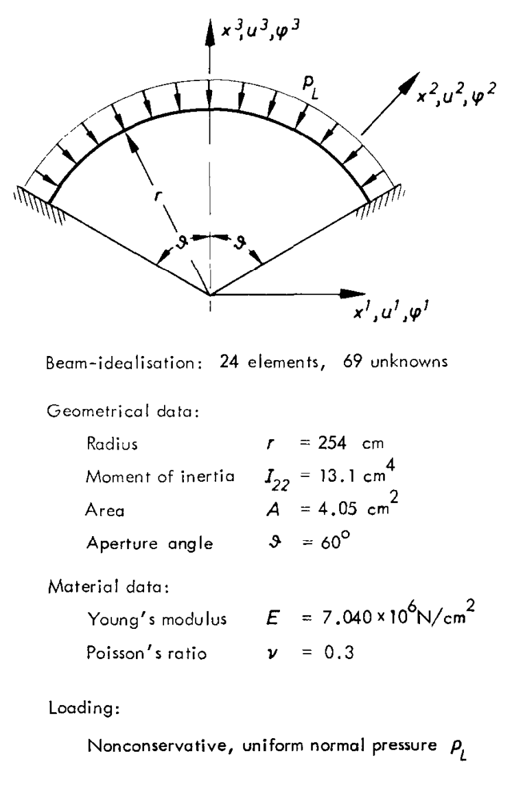

```@meta
EditURL = "../../../test/examples/staticStructural/archUnderFollowerPressure.jl"
```

# Static structural analysis of an arch under follower pressure
This example simulates the static response of a clamped arch subjected to a normal (follower) pressure. It illustrates how to set up a steady structural problem for an initially curved beam subjected to follower distributed loads. The problem was defined by [Argyris and Symeonidis](https://doi.org/10.1016/0045-7825(81)90131-6).


*Clamped circular arch under normal pressure* by [Argyris and Symeonidis](https://doi.org/10.1016/0045-7825(81)90131-6)

!!! tip
    The code for this example is available [here](https://github.com/luizpancini/AeroBeams.jl/blob/main/test/examples/staticStructural/archUnderFollowerPressure.jl).

### Beam
The first step is to create a beam. The arch has radius `R` and spans over and angle `θ`. The curvature of the beam is thus `1/R`, and the total length is `L=Rθ`. We define the beam orientation such that the arch spans from an angle `-θ/2` to `θ/2` about a vertical line. This is done by specifying the rotation parameters from basis `A` to basis `b`, `p0`, with the Euler parameters sequence 3-2-1: the angle of rotation about the second axis is `-θ/2`. The cross-section has area `A` and bending moment of inertia `Iy`. The elastic modulus of the material is `E`. We discretize the beam into `nElem` finite elements. In this case the properties of the beam are constant over its length, to see a case where those properties vary, check this [example](https://github.com/luizpancini/AeroBeams.jl/blob/main/test/examples/eigenStructural/taperedBeamEigen.jl).

````@example archUnderFollowerPressure
# Beam
using AeroBeams

R,θ = 2.54, deg2rad(120)
k2 = 1/R
L = R*θ
A,Iy = 4.05e-4, 13.1e-8
E = 70.4e9
EA,EIy = E*A,E*Iy
nElem = 40
beam = create_Beam(name="arch",length=L,nElements=nElem,S=[isotropic_stiffness_matrix(∞=1e12,EA=EA,EIy=EIy)],p0=transform_to_WM([0;-θ/2;0]; from=:E321),k=[0;k2;0]);
nothing #hide
````

### BCs
Now we create the boundary conditions (including the pressure load). The normalized load is defined by the `λ` variable, and the maximum value of the actual distributed load per unit length is `q`. We add this constant load to the arch as a distributed follower force initially resolved in basis `b`. We then clamp both ends of the beam (nodes `1` and `nElem+1`) by setting the displacements and rotations to zero.

````@example archUnderFollowerPressure
# BCs
λ = 15
q = -λ*EIy/R^2
add_distributed_loads_to_beam!(beam=beam,loads=Dict(:ff_b_of_x1t => (x1,t)->[0; 0; q]))
clamp1 = create_BC(name="clamp1",beam=beam,node=1,conditions=Dict(:u1A=>0,:u2A=>0,:u3A=>0,:p1A=>0,:p2A=>0,:p3A=>0))
clamp2 = create_BC(name="clamp2",beam=beam,node=nElem+1,conditions=Dict(:u1A=>0,:u2A=>0,:u3A=>0,:p1A=>0,:p2A=>0,:p3A=>0))
nothing #hide
````

### Model
We are now ready to create the model itself. It is composed of the beam and the boundary conditions.

````@example archUnderFollowerPressure
# Model
archUnderFollowerPressure = create_Model(name="archUnderFollowerPressure",beams=[beam],BCs=[clamp1,clamp2])
nothing #hide
````

### System solver
We can set an optional system solver for the nonlinear algebraic system of equations resulting from the finite element discretization. In this case we need to use an arc-length solver in order to go beyond the snap-through point. An appropriate choice for the maximum arc length in this case, found by trial and error, is 0.1.

````@example archUnderFollowerPressure
# System solver
systemSolver = create_ArclengthSolver(maxArcLength=0.1)
nothing #hide
````

### Problem
Now we define the steady problem, by inputting the model and our optional system solver, and then solve it.

````@example archUnderFollowerPressure
# Problem
problem = create_SteadyProblem(model=archUnderFollowerPressure,systemSolver=systemSolver)
solve!(problem)
nothing #hide
````

### Post-processing
We are interested in the behavior of the arch's midpoint transverse displacement (in the x3 direction) as a function of the load. So we can get solution history at all partial load steps. The array of the partial load factors is `σVec`, and the corresponding midpoint displacements are `mid_u3`.

````@example archUnderFollowerPressure
# Unpack outputs
hist = problem.loadstepHistory
σVec = hist.σ
states = hist.states
mid_u3 = [states[i][div(nElem,2)].nodal.u2[3] for i in 1:length(σVec)]
nothing #hide
````

The following plot shows the midpoint displacement as a function of the load. Notice that the load-displacement curve is initially very stiff and then softens as the arch approaches the snap-through point.

````@example archUnderFollowerPressure
lw = 2
gr()
ENV["GKSwstype"] = "100" #hide
# Plot displacement
plot(-mid_u3/R, σVec*λ, c=:black, lw=lw, xlabel="Midpoint \$-u_3/R\$", ylabel="\$\\lambda\$", label=false)
savefig("archUnderFollowerPressure_disp.svg") #hide
nothing #hide
````


Let's also plot the initial and final deformed shape of the arch, along with the boundary conditions. To do that, we exploit AeroBeams' built-in visualization capabilities, by simply calling the `plot_steady_deformation()` function accordingly.

````@example archUnderFollowerPressure
# Plot deformed shape
plot_steady_deformation(problem)
savefig("archUnderFollowerPressure-deformed.svg") #hide
nothing #hide
````


---

*This page was generated using [Literate.jl](https://github.com/fredrikekre/Literate.jl).*

