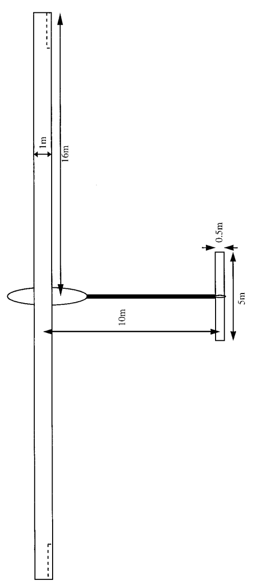

```@meta
EditURL = "../../../test/examples/dynamicAeroelastic/cHALECheckedPitchManeuver.jl"
```

# Pitch maneuver of a HALE aircraft
This example illustrates how to set up a dynamic analysis of an aircraft in free flight. For that we take a high-altitude long-endurance (HALE) aircraft model described by [Patil, Hodges and Cesnik](https://doi.org/10.2514/2.2738):


*HALE model geometry* by [Patil, Hodges and Cesnik](https://doi.org/10.2514/2.2738)

!!! tip
    The code for this example is available [here](https://github.com/luizpancini/AeroBeams.jl/blob/main/test/examples/dynamicAeroelastic/cHALECheckedPitchManeuver.jl).

### Problem setup
Let's begin by setting up the variables of our problem.

````@example cHALECheckedPitchManeuver
using AeroBeams

# Altitude [m]
h = 20e3

# Airspeed [m/s]
U = 25

# Wing and stabilizers parasite drag and flag for induced drag
wingCd0 = stabsCd0 = 1e-2
hasInducedDrag = true

# Aerodynamic solver
aeroSolver = Indicial()

# Discretization
nElemWing = 20
nElemTailBoom = 5
nElemHorzStabilizer = 4
nElemVertStabilizer = 2
nothing #hide
````

### Trim problem
We have to first trim the aircraft at the specified flight condition. Our trim variables are the engine's thrust (modeled as a follower force at the root of the wing), and the elevator deflection. For the trim problem, we set a Newton-Raphson solver through [`create_NLsolver`](@ref create_NLsolver) with the pseudoinverse method for the linear step (`trimSolverMethod=:pinv`). We use the built-in function [`create_cHALE`](@ref create_cHALE) to streamline the model creation process. A dedicated [example](cHALEmodel.md) explains the inner workings of that function.

````@example cHALECheckedPitchManeuver
# System solver
systemSolver = create_NLsolver(trimSolverMethod=:pinv)

# Model for trim problem
cHALEtrim,_ = create_cHALE(aeroSolver=aeroSolver,altitude=h,airspeed=U,wingCd0=wingCd0,stabsCd0=stabsCd0,hasInducedDrag=hasInducedDrag,nElemWing=nElemWing,nElemTailBoom=nElemTailBoom,nElemHorzStabilizer=nElemHorzStabilizer,nElemVertStabilizer=nElemVertStabilizer,δElevIsTrimVariable=true,thrustIsTrimVariable=true)

# Create and solve trim problem
trimProblem = create_TrimProblem(model=cHALEtrim,systemSolver=systemSolver)
solve!(trimProblem)

# Get wing and horizontal tail elements
leftWingRootElem = div(nElemWing,2)
rightWingRootElem = leftWingRootElem + 1
leftHTRootElem = nElemWing + nElemTailBoom + div(nElemHorzStabilizer,2)
rightHTRootElem = leftHTRootElem + 1

# Extract trim variables and outputs
trimSol = trimProblem.trimSolution
trimAeroVars = trimProblem.loadstepHistory.aeroVariables[end]
trimAoA = (trimAeroVars[leftWingRootElem].unsteadyKin.αₑ + trimAeroVars[rightWingRootElem].unsteadyKin.αₑ)/2
trimThrust = trimSol.trimLoads[1]
trimδ = trimSol.trimδ[1]
nothing #hide
````

### Dynamic problem
The pitch maneuver investigated is defined by a checked elevator deflection, linearly ramped. The amplitude of the deflection, `Δδ`, is negative so as to command a climb (at least initially). The time-dependent elevator profile, `δ`, is then passed as an argument to create the model for the dynamic problem.

````@example cHALECheckedPitchManeuver
using Suppressor #hide
# Set checked elevator deflection profile
Δδ = deg2rad(-10)
tδinit = 5
tδramp = 1
tδpeak = tδinit+tδramp
tδfinal = tδpeak+tδramp
δ = t -> ifelse(
    t <= tδinit,
    trimδ,
    ifelse(
        t <= tδpeak,
        trimδ + Δδ * ((t-tδinit) / (tδpeak-tδinit)),
        ifelse(
            t <= tδfinal,
            trimδ + Δδ - Δδ * ((t-tδpeak) / (tδfinal-tδpeak)),
            trimδ
        )
    )
)

# Model for dynamic problem
cHALEdyn,_ = create_cHALE(aeroSolver=aeroSolver,altitude=h,airspeed=U,wingCd0=wingCd0,stabsCd0=stabsCd0,hasInducedDrag=hasInducedDrag,nElemWing=nElemWing,nElemTailBoom=nElemTailBoom,nElemHorzStabilizer=nElemHorzStabilizer,nElemVertStabilizer=nElemVertStabilizer,δElev=δ,thrust=trimThrust)
nothing #hide

# Time variables
Δt = 5e-2
tf = 60

# Set system solver for dynamic problem
NRdyn = create_NLsolver(method=:newton)

# Create and solve dynamic problem
dynamicProblem = create_DynamicProblem(model=cHALEdyn,x0=trimProblem.systemArrays.x[cHALEtrim.assemblyData.rangeNominal],finalTime=tf,Δt=Δt,systemSolver=NRdyn)
@suppress begin #hide
solve!(dynamicProblem)
end #hide
nothing #hide
````

### Post-processing
The first post-processing step is to unpack the desired outputs.

````@example cHALECheckedPitchManeuver
# Unpack numerical solution
sol = dynamicProblem.solutionHistory
t = sol.t
states = sol.states
aeroVars = sol.aeroVariables
wingAoA = rad2deg.([(aeroVars[i][leftWingRootElem].unsteadyKin.αₑ + aeroVars[i][rightWingRootElem].unsteadyKin.αₑ)/2 for i in eachindex(t)])
htAoA = rad2deg.([(aeroVars[i][leftHTRootElem].unsteadyKin.αₑ + aeroVars[i][rightHTRootElem].unsteadyKin.αₑ)/2 for i in eachindex(t)])
Δu1 = [(cHALEdyn.kinematicsBasisA.u_AVec[i][1] + states[i][leftWingRootElem].nodal.u2[1]) for i in eachindex(t)] .- states[1][leftWingRootElem].nodal.u2[1]
Δu2 = [(cHALEdyn.kinematicsBasisA.u_AVec[i][2] + states[i][leftWingRootElem].nodal.u2[2]) for i in eachindex(t)] .- states[1][leftWingRootElem].nodal.u2[2]
Δu3 = [(cHALEdyn.kinematicsBasisA.u_AVec[i][3] + states[i][leftWingRootElem].nodal.u2[3]) for i in eachindex(t)] .- states[1][leftWingRootElem].nodal.u2[3]
airspeed = [norm(aeroVars[i][leftWingRootElem].steadyKin.U + aeroVars[i][rightWingRootElem].steadyKin.U)/2 for i in eachindex(t)]
nothing #hide
````

We are now ready to visualize the results through the changes in forward distance and altitude, root angle of attack at the wing and tail, and airspeed.

````@example cHALECheckedPitchManeuver
gr()
ENV["GKSwstype"] = "100" #hide

# Forward distance
plt1 = plot(xlabel="Time [s]", ylabel="Forward distance [m]")
plot!(t, Δu2, c=:black, lw=2, label=false)
savefig("cHALECheckedPitchManeuver_fdist.svg") #hide

# Altitude
plt2 = plot(xlabel="Time [s]", ylabel="Altitude [m]")
plot!(t, Δu3, c=:black, lw=2, label=false)
savefig("cHALECheckedPitchManeuver_altitude.svg") #hide

# Root AoA
plt3 = plot(xlabel="Time [s]", ylabel="Root angle of attack [deg]")
plot!(t, wingAoA, c=:black, lw=2, label="Wing")
plot!(t, htAoA, c=:blue, lw=2, label="HT")
savefig("cHALECheckedPitchManeuver_AoA.svg") #hide

# Airspeed
plt4 = plot(xlabel="Time [s]", ylabel="Airspeed [m/s]")
plot!(t, airspeed, c=:black, lw=2, label=false)
savefig("cHALECheckedPitchManeuver_airspeed.svg") #hide
nothing #hide
````


Let's also visualize the motion of the aircraft through the view of an observer at the body-attached basis A. For that, we use the [`plot_dynamic_deformation`](@ref plot_dynamic_deformation) function with `follow=:basisA` and other appropriate arguments.

````@example cHALECheckedPitchManeuver
@suppress begin #hide
plot_dynamic_deformation(dynamicProblem,view=(30,15),plotBCs=false,plotDistLoads=false,plotFrequency=10,plotLimits=([-20,20],[-10,250],[-20,20]),save=true,savePath="/docs/build/literate/cHALECheckedPitchManeuver_motion.gif")
nothing #hide
end #hide
````


````@example cHALECheckedPitchManeuver
nothing #hide
````

---

*This page was generated using [Literate.jl](https://github.com/fredrikekre/Literate.jl).*

