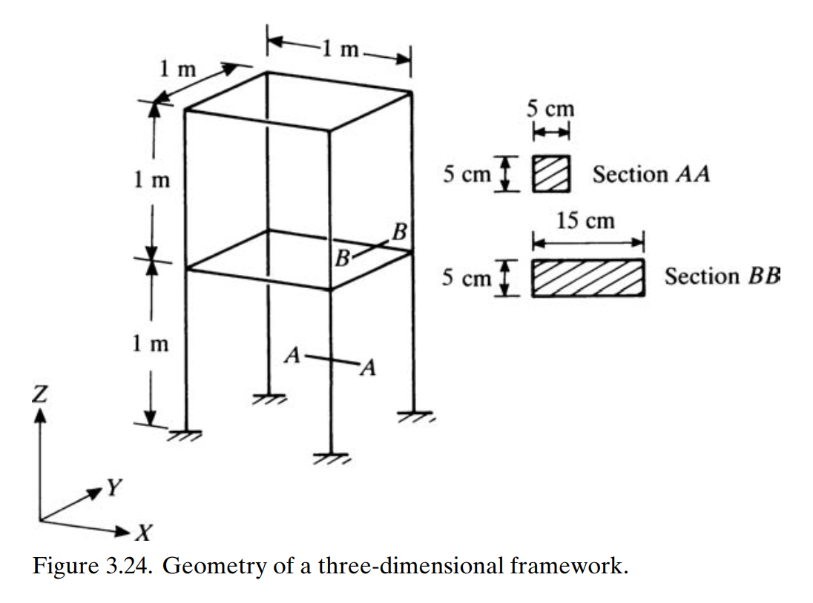
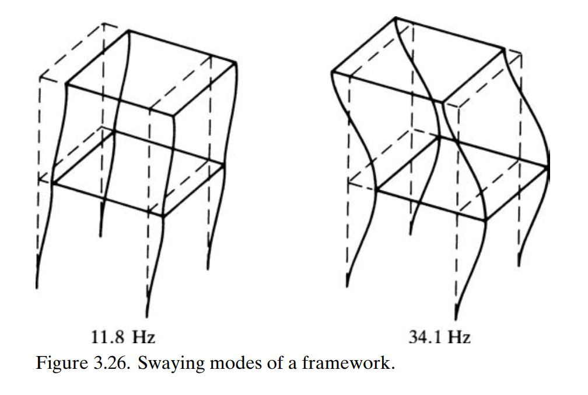

```@meta
EditURL = "../../../test/examples/eigenStructural/twoStoryFrame.jl"
```

# Modal analysis of a two-story frame
This example illustrates how to set up a modal analysis, using a two-story beam frame. Moreover, it also shows how to assemble a model where the beams are not all connected in sequence. This problem was proposed by [Petyt](https://doi.org/10.1017/CBO9780511761195).



*Geometry of the two-story frame* by [Petyt](https://doi.org/10.1017/CBO9780511761195)

!!! tip
    The code for this example is available [here](https://github.com/luizpancini/AeroBeams.jl/blob/main/test/examples/eigenStructural/twoStoryFrame.jl).

### Problem variables
The first step is to define the variables of our problem: geometric and material properties, and discretization. There are two types of beams in the frame: vertical ones have cross-section base `b1` and horizontal ones have base `b2`, but all are made of the same material. We also apply an uniform discretization.

````@example twoStoryFrame
using AeroBeams

# Geometric properties
L = 1
b1,b2,h = 5e-2, 15e-2, 5e-2
A1,Iy1,Iz1 = b1*h, b1*h^3/12, h*b1^3/12
A2,Iy2,Iz2 = b2*h, b2*h^3/12, h*b2^3/12
J1 = A1^4/(Iy1+Iz1)/40
J2 = A2^4/(Iy2+Iz2)/40
Kt1,Kt2 = 10/9, 3.0864
nothing #hide

# Assembly angles
α = [0, 0, π/2, 0, 0, π/2, 0, 0, 0, 0, 0, 0, π/2, 0, 0, π/2]
β = -[π/2, π/2, 0, -π/2, -π/2, 0, 0, 0, 0, 0, -π/2, π/2, 0, -π/2, -π/2, 0]
nothing #hide

# Material properties
E = 219.9e9
ν = 0.25
G = E/(2*(1+ν))
ρ = 7.9e3
∞ = 1e12
nothing #hide

# Stiffness and inertia matrices
S1 = isotropic_stiffness_matrix(∞=∞,EA=E*A1,GJ=G*J1*Kt1,EIy=E*Iy1,EIz=E*Iz1)
S2 = isotropic_stiffness_matrix(∞=∞,EA=E*A2,GJ=G*J2*Kt2,EIy=E*Iy2,EIz=E*Iz2)
I1 = inertia_matrix(ρ=ρ,A=A1,Iy=Iy1,Iz=Iz1)
I2 = inertia_matrix(ρ=ρ,A=A2,Iy=Iy2,Iz=Iz2)

S = [S1, S1, S2, S1, S1, S2, S2, S2, S2, S2, S1, S1, S2, S1, S1, S2]
I = [I1, I1, I2, I1, I1, I2, I2, I2, I2, I2, I1, I1, I2, I1, I1, I2]
nothing #hide

# Number of elements for each beam
nElem = 10
nothing #hide
````

### Beams of the frame
In the following we create the array of beams. Notice that their disposition in space is defined by the rotation parameters `p0` from the body-attached (global) basis ``\mathcal{A}`` to the undeformed beam basis ``b^+``. Moreover, since this is a frame, the beams are not all connected in sequence. That means there are connections between beams, which need to be specified. That is done by setting `beamConnections` (a vector of beam connection pairs) and `nodeConnections` (a vector of the corresponding node pairs that are connected).

````@example twoStoryFrame
# Beams
beams = [create_Beam(
    name="beam$i",
    length=L,
    nElements=nElem,
    S=[S[i]],
    I=[I[i]],
    p0=transform_to_WM([α[i], β[i], 0],from=:E321))
    for i in 1:16
    ]
nothing #hide

# Beam and node connections
connections = [
    (beams[2] => beams[1], 1 => nElem+1),
    (beams[3] => beams[2], 1 => nElem+1),
    (beams[4] => beams[3], 1 => nElem+1),
    (beams[5] => beams[4], 1 => nElem+1),
    (beams[6] => beams[1], 1 => nElem+1),
    (beams[6] => beams[4], nElem+1 => nElem+1),
    (beams[7] => beams[1], 1 => nElem+1),
    (beams[8] => beams[4], 1 => nElem+1),
    (beams[9] => beams[2], 1 => nElem+1),
    (beams[10] => beams[3], 1 => nElem+1),
    (beams[11] => beams[7], 1 => nElem+1),
    (beams[12] => beams[7], 1 => nElem+1),
    (beams[12] => beams[9], nElem+1 => nElem+1),
    (beams[13] => beams[9], 1 => nElem+1),
    (beams[13] => beams[10], nElem+1 => nElem+1),
    (beams[14] => beams[13], 1 => nElem+1),
    (beams[14] => beams[8], nElem+1 => nElem+1),
    (beams[15] => beams[8], 1 => nElem+1),
    (beams[16] => beams[7], 1 => nElem+1),
    (beams[16] => beams[8], nElem+1 => nElem+1),
]
nothing #hide
````

### Boundary conditions
The frame is clamped at the four base points.

````@example twoStoryFrame
# BCs
clampedBeams = [beams[1],beams[5],beams[11],beams[15]]
clampedNodes = [1,nElem+1,nElem+1,nElem+1]
clamps = [create_BC(
    name="clamp$i",
    beam=beam,
    node=node,
    conditions=Dict(:u1A=>0,:u2A=>0,:u3A=>0,:p1A=>0,:p2A=>0,:p3A=>0))
    for (i,(beam,node)) in enumerate(zip(clampedBeams,clampedNodes))
    ]
nothing #hide
````

### Model
Our model is composed of the beams and boundary conditions. We further specify the units, merely for plotting purposes, using the constructor [`create_UnitsSystem`](@ref create_UnitsSystem).

````@example twoStoryFrame
# Model
twoStoryFrame = create_Model(
    name="twoStoryFrame",
    beams=beams,
    connections=connections,
    BCs=clamps,
    units=create_UnitsSystem(length="m",frequency="Hz")
    )
nothing #hide
````

p1 = plot_undeformed_assembly(twoStoryFrame, view=(30,30))
display(p1)

### System solver
We create a linear system solver, which will be used to solve the eigenproblem.

````@example twoStoryFrame
# System solver
solver = create_LinearSolver()
nothing #hide
````

### Create and solve problem
We create and solve the eigenproblem, specifying the model, the linear system solver, the eigensolver method, and the number of eigenvalues to be computed.

````@example twoStoryFrame
# Number of modes to track
nModes = 4

# Eigensolver method and minimum number of eigenvalues to be computed
eigenmethod = :krylovkit
nev = 40

# Problem
problem = create_EigenProblem(
    model=twoStoryFrame,
    systemSolver=solver,
    eigenmethod=eigenmethod,
    nev=nev
    )
solve!(problem)
nothing #hide
````

### Post-processing
We can now extract the frequencies of vibration and compare to the reference finite element solution. The agreement is very good. Notice that only the first and seconding bending mode (swaying modes) in a specific direction are compared, since this problem is symmetric.

````@example twoStoryFrame
# Unpack eigenvalues
λ = problem.eigensolution.λ

# Get oscillatory frequencies in Hz and keep desired number of modes
freqs,_ = filter_tracked_modes(rads2Hz.(imag.(λ)), fmin=eps(), maxTracks=nModes)

# Reference frequencies (in Hz)
refFreqs = [11.8, 34.1]

# Display relative errors
ϵ_rel = freqs[[1,4]]./refFreqs .- 1.0
println("Relative frequency errors: $(round.(100ϵ_rel, sigdigits=2)) %")
nothing #hide
````

We can also visualize the mode shapes using the function [`plot_mode_shapes`](@ref plot_mode_shapes) with the appropriate arguments. They compare well to thosed described in the reference.

````@example twoStoryFrame
modesPlot = plot_mode_shapes(problem,nModes=nModes,view=(45,30),legendPos=(0.4,0.95))
savefig("twoStoryFrame_modeShapes.svg") #hide
nothing #hide
````




*Swaying modes of the two-story frame* by [Petyt](https://doi.org/10.1017/CBO9780511761195)

---

*This page was generated using [Literate.jl](https://github.com/fredrikekre/Literate.jl).*

