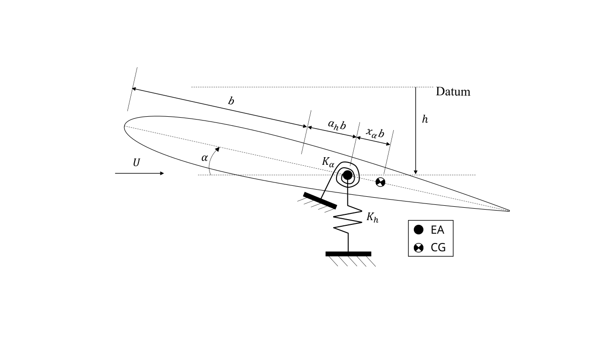

```@meta
EditURL = "../../../test/examples/eigenAeroelastic/typicalSectionFlutterAndDivergence.jl"
```

# Flutter and divergence of a typical aeroelastic section
This example illustrates how to set up a flutter/divergence analysis of a 2-DOF typical aeroelastic section. The typical section used was defined by [Hodges and Pierce](https://doi.org/10.1017/CBO9780511997112).


*Typical section*

!!! tip
    The code for this example is available [here](https://github.com/luizpancini/AeroBeams.jl/blob/main/test/examples/eigenAeroelastic/typicalSectionFlutterAndDivergence.jl).

### Problem setup
Let's begin by setting up the variables of our problem: we'll model the 2-DOF (pitch and plunge) typical section, which is a two-dimensional idealization, by setting up a rigid wing supported by displacement and rotation springs. We leverage the function [`typical_section_data`](@ref typical_section_data) to extract the typical section parameters.

````@example typicalSectionFlutterAndDivergence
using AeroBeams

# Aerodynamic solver
aeroSolver = Inflow()

# Atmosphere
altitude = 0
atmosphere = standard_atmosphere(altitude)
ρ = atmosphere.ρ

# Given typical section data
typicalSectionName = "HP-1"
airfoil = deepcopy(FlatPlate)
a,e,μ,rα²,σ,ωα,c = typical_section_data(typicalSectionName)

# Derived typical section data: semichord, mass per unit length, pitching inertia, distance from elastic axis to mass axis, plunge stiffness and pitch stiffness
b = c/2
m = μ * π*ρ*b^2
Iα = rα²*m*b^2
e2 = -(e-a)*b
kh = m*(σ*ωα)^2
kα = Iα*ωα^2

# Number of elements for the wing (the results are independent of it)
nElem = 2
nothing #hide
````

We now create the aerodynamic surface to be attached to the wing's beam, the attachment springs, and the rigid beam of the wing. Two sliding journals (allowing only pitch and plunge motion) are added at the wingtips, further removing any elastic effects of the beam.

````@example typicalSectionFlutterAndDivergence
# Aerodynamic surface
surf = create_AeroSurface(ppSolver=aeroSolver,airfoil=airfoil,c=c,normSparPos=(a+1)/2,updateAirfoilParameters=false)
nothing #hide

# Rigid wing
L = 1
∞ = 1e10
wing = create_Beam(name="wing",length=L,nElements=nElem,S=[isotropic_stiffness_matrix(∞=∞)],I=[inertia_matrix(ρA=m,ρIy=Iα/2,ρIz=Iα/2,e2=e2)],surface=surf)
nothing #hide

# Attachment springs (in pitch and plunge)
pitchSpring = create_Spring(kp=kα)
plungeSpring = create_Spring(ku=kh)
add_spring_to_beam!(beam=wing,spring=plungeSpring,nodeID=div(nElem,2)+1,p=[0,π/2,0])
add_spring_to_beam!(beam=wing,spring=pitchSpring,nodeID=div(nElem,2)+1)
nothing #hide

# BCs
journal1 = create_BC(name="journal-1",beam=wing,node=1,conditions=Dict(:u1A=>0,:u2A=>0,:p2A=>0,:p3A=>0))
journal2 = create_BC(name="journal-2",beam=wing,node=nElem+1,conditions=Dict(:u1A=>0,:u2A=>0,:p2A=>0,:p3A=>0))
nothing #hide
````

The model consists of the beam and boundary conditions. We also select the airspeed range for analysis, the number of oscillatory modes to be extracted and initialize the outputs.

````@example typicalSectionFlutterAndDivergence
# Model
typicalSectionFlutterAndDivergence = create_Model(name="typicalSectionFlutterAndDivergence",beams=[wing],BCs=[journal1,journal2])

# Airspeed range
URangeNorm = collect(0.025:0.025:3)
URange = b * ωα * URangeNorm

# Number of modes to track
nModesOsc = 2
nModesNonOsc = 1

# Eigensolver method and minimum number of eigenvalues to be computed
eigenmethod = :krylovkit
nev = 20

# Initialize outputs
eigensols = Array{EigenSolution}(undef,length(URange))
nothing #hide
````

### Problem solution
We're now ready to solve the eigenproblem at each airspeed value.

````@example typicalSectionFlutterAndDivergence
# Initialize guess solution
x0 = zeros(0)
# Sweep airspeed
for (i,U) in enumerate(URange)
    # Update airspeed on model
    update_v_A!(typicalSectionFlutterAndDivergence,v_A=[0,U,0])
    # Create and solve eigenproblem
    problem = create_EigenProblem(model=typicalSectionFlutterAndDivergence,eigenmethod=eigenmethod,nev=nev,x0=x0)
    solve!(problem)
    # Eigensolution
    eigensols[i] = problem.eigensolution
    # Set initial guess solution for next iteration
    global x0 = problem.systemArrays.x
end
nothing #hide
````

### Post-processing
The first post-processing step is to use the built-in mode tracking algorithm to enhance our chances of correctly tracking modes, while also extracting frequencies and dampings from the eigensolution. Then, we filter the tracked modes into oscillatory and non-oscillatory categories. With that, we can find the flutter and divergence variables of interest.

````@example typicalSectionFlutterAndDivergence
# Apply mode tracking
freqs,damps,_ = mode_tracking(eigensols)

# Get frequencies and dampings of oscillatory and non-oscillatory modes
freqsOsc,dampsOsc,_ = filter_tracked_modes(freqs,damps; fmin=eps(), fmax=1.5*ωα, maxTracks=nModesOsc, dropOutsideBounds=true)
freqsNonOsc,dampsNonOsc,_ = filter_tracked_modes(freqs,damps; fmin=0, fmax=0, maxTracks=nModesNonOsc)

# Flutter speed and frequency
flutterOnsetSpeeds,flutterOnsetFreqs,_ = find_flutter(URange,freqsOsc,dampsOsc)
flutterSpeed = minimum(flutterOnsetSpeeds)
flutterFreq = minimum(flutterOnsetFreqs)

# Divergence speed
divergenceSpeeds,divergenceMode,_ = find_divergence(URange,freqsNonOsc,dampsNonOsc)
divergenceSpeed = minimum(divergenceSpeeds)
nothing #hide
````

We also load a reference solution obtained using the ``p`` method for stability analysis using the unsteady aerodynamic theory of [Peters et al.](https://doi.org/10.2514/3.46718), as proposed in problem 5.7 of [Hodges and Pierce](https://doi.org/10.1017/CBO9780511997112).

````@example typicalSectionFlutterAndDivergence
# Load reference data
freqsRef = readdlm(pkgdir(AeroBeams)*"/test/referenceData/typicalSectionFlutterAndDivergence/freqs.txt")
dampsRef = readdlm(pkgdir(AeroBeams)*"/test/referenceData/typicalSectionFlutterAndDivergence/damps.txt")
nothing #hide
````

We'll visualize the results through the V-g-f diagrams, *i.e.*, the evolution of the frequencies and dampings (both normalized by the *in vacuo* pitching frequency) with airspeed. The flutter speed is that at which the damping of an oscillatory mode, in this case the pitch mode, becomes positive. Conversely, the divergence speed is that at which the damping of a non-oscillatory mode becomes positive. The results match almost exactly.

````@example typicalSectionFlutterAndDivergence
gr()
ENV["GKSwstype"] = "100" #hide
nothing #hide

# Plot configurations
modeColors = cgrad(:rainbow, nModesOsc+nModesNonOsc, categorical=true)
modeLabels = ["Plunge", "Pitch", "Non-oscillatory"]
lw = 3
msw = 0
nothing #hide

# Frequency plot
plt11 = plot(ylabel="Frequency ratio", xlims=extrema(URangeNorm), ylims=[0,1.02])
for mode in 1:nModesOsc
    plot!(URangeNorm, freqsOsc[mode,:]/ωα, c=modeColors[mode], lw=lw, label=false)
end
plot!(freqsRef[1,:], freqsRef[2,:], ls=:dash, lw=1, marker=:circle, ms=2, msw=msw, c=:black, label=false)
# Damping plot
plt12 = plot(xlabel="Normalized airspeed, \$U/b\\omega_\\alpha\$", ylabel="Damping ratio", xlims=extrema(URangeNorm), ylims=[-0.15,0.15], legend=:topleft)
for mode in 1:nModesOsc
    plot!(URangeNorm, dampsOsc[mode,:]/ωα, c=modeColors[mode], lw=lw, label=modeLabels[mode])
end
for mode in 1:nModesNonOsc
    plot!(URangeNorm, dampsNonOsc[mode,:]/ωα, c=modeColors[nModesOsc+mode], lw=lw, label=modeLabels[nModesOsc+mode])
end
plot!(dampsRef[1,:], dampsRef[2,:], ls=:dash, lw=1, marker=:circle, ms=2, msw=msw, c=:black, label="Hodges & Pierce (2011) - \$p\$ method")
plt1 = plot(plt11, plt12, layout=(2,1))
savefig("typicalSectionFlutter_Vgf.svg") #hide
nothing #hide
````


Finally, we show the numerical values of the nondimensional flutter speed and frequency. The values computed by Hodges & Pierce are 2.165 and 0.6545, respectively.

````@example typicalSectionFlutterAndDivergence
# Nondimensional speeds and frequencies
Ud = divergenceSpeed / (b * ωα)
Uf = flutterSpeed / (b * ωα)
ωf = flutterFreq / ωα
nothing #hide

# Reference values
UfRef = 2.165
ωfRef  = 0.6545
nothing #hide

# Relative errors (%)
ϵUf = 100 * (Uf./UfRef .- 1)
ϵωf  = 100 * (ωf./ωfRef .- 1)
nothing #hide

# Pretty table of results
data = [
    "Divergence speed"   Ud  missing missing
    "Flutter speed"      Uf  UfRef   ϵUf
    "Flutter frequency"  ωf  ωfRef   ϵωf
]
pretty_table(
    data;
    column_labels = ["", "AeroBeams", "Hodges & Pierce", "Δ [%]"],
    title         = "Pitch-plunge typical section",
    formatters    = [
        (v, i, j) -> (v isa Number) ? round(v, sigdigits=4) : v,
        (v, i, j) -> (j == 4 && v isa Number) ? string(round(v, digits=2), " %") : v,
    ],
    source_notes  = "Reference: Hodges & Pierce, Introduction to Structural Dynamics and Aeroelasticity",
)
nothing #hide
````

---

*This page was generated using [Literate.jl](https://github.com/fredrikekre/Literate.jl).*

